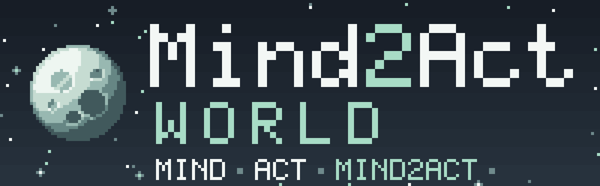

<p align="center">
  
</p>

# A Diagnostic Benchmark for Embodied Mind, Physical Action, and Mind-Action Composition in Robotic Manipulation

**30 tasks in 3 suites** · **180 task configurations** · **12 capability categories** · **4,500 demonstrations**

Mind2Act World evaluates **Mind** (remembering and reasoning over task-relevant information), **Act** (precise, reliable physical execution), and **Mind-Action composition** (coordinating the two through environment feedback) *separately and in combination*. Comparing one system across the three views shows whether a failure comes from Mind, from Act, or from their composition. Beyond success rate, the scorers record stage progress and event-level evidence, so each failed episode is traced back to one of the three. Every evaluated model also gets a **diagnosis card**.

## 🧠 Three views

| View | Question it answers | Tasks |
| --- | --- | --- |
| **Mind** | Can the robot remember and reason to pick the correct next step? | 10 (e.g. Memory Card Matching, Order-Based Meal Assembly) |
| **Act** | Can it execute precise, well-timed actions under physical constraints? | 10 (e.g. Continuous Conveyor Picking, Marker Line Tracing) |
| **Mind2Act** | Can it chain dependent steps, where each physical outcome decides the next? | 10 (e.g. Bridge Construction, Dual-Arm Cooking) |

Each task has three difficulty levels and runs in both Clean and Random scenes (clutter, varied materials and lighting). Agents and end-to-end VLA/WAM policies use separate protocols and leaderboards.

## 🔗 Links

- 🌐 **Website & leaderboard**: [mind2act-world.com](https://mind2act-world.com/)
- 💻 **Code** (evaluation code and task assets): coming soon
- 📄 **Technical report**: coming soon
- 🤗 **Dataset** (task configurations and demonstrations): coming soon

## 📦 GitHub Repositories

Coming soon. The evaluation code and task assets will be released here.

## 📚 Citation

```bibtex
@misc{mind2act_world,
  title        = {Mind2Act World: A Diagnostic Benchmark for Embodied Mind, Physical Action, and Mind-Action Composition in Robotic Manipulation},
  author       = {Mind2Act Team},
  year         = {2026},
  howpublished = {\url{https://mind2act-world.com/}}
}
```
